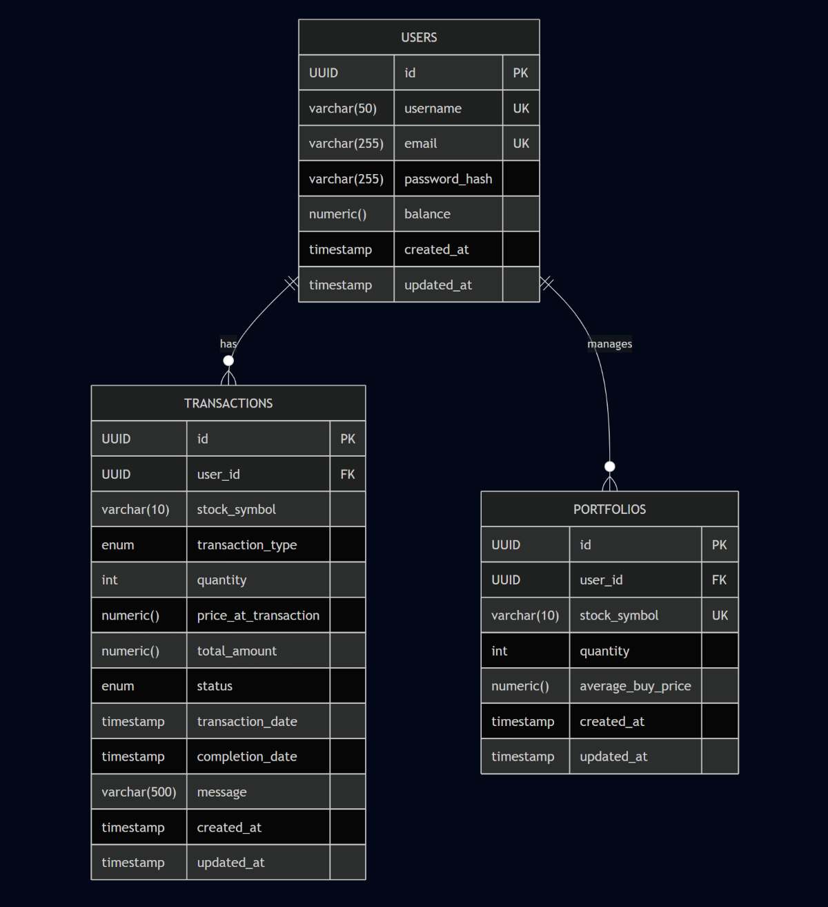
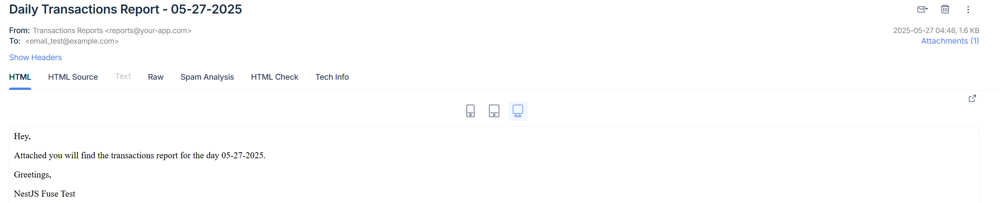
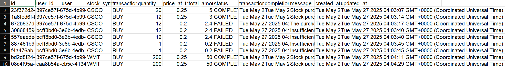

# API Project Design Report

## Why NestJS?

NestJS was chosen as the primary framework for this project due to its:

* **Architectural Clarity:** NestJS promotes a modular, scalable, and easily maintainable application structure inspired by Angular, using decorators, modules, and providers. This leads to cleaner code separation and better organization.
* **Built-in Features:** It comes with robust built-in modules for HTTP (via `HttpModule`), caching (`CacheModule`), and scheduling (`ScheduleModule`), significantly accelerating development and providing battle-tested solutions for common enterprise needs.
* **TypeScript Support:** Being built with TypeScript, it offers strong typing, improving code quality, readability, and reducing runtime errors, which is crucial for a financial application.
* **Dependency Injection:** Its powerful dependency injection system simplifies testing and managing application components.

---

## Database & ORM Choices in This Project

This document outlines the rationale behind key database and ORM choices made for this project, focusing on the selection of PostgreSQL and TypeORM, as well as critical architectural decisions like pessimistic locking.

---

## Why PostgreSQL?

**PostgreSQL** was chosen as the primary database for this project due to its robust feature set, reliability, and strong support for complex data operations.

### Key Advantages:

* **Reliability & Data Integrity:** PostgreSQL is renowned for its stability, adherence to SQL standards, and strong support for ACID (Atomicity, Consistency, Isolation, Durability) properties, making it an excellent choice for financial transactions and critical data.
* **Advanced Features:** It offers a rich set of advanced features out-of-the-box, including JSONB support, geo-spatial data types (PostGIS), full-text search, and a highly extensible plugin system. This provides flexibility for future enhancements without needing to switch databases.
* **Concurrency Control:** PostgreSQL's Multi-Version Concurrency Control (MVCC) ensures high concurrency by allowing readers and writers to operate on different versions of data, minimizing lock contention.
* **Open Source & Community Support:** Being open-source, it benefits from a large, active community, ensuring continuous development, extensive documentation, and readily available support.
* **Scalability:** While traditionally seen as a vertical scaler, PostgreSQL can be scaled horizontally with various techniques and tools, making it suitable for growing applications.

---

### Entity Relational Diagram


---

## Why TypeORM?

**TypeORM** was selected as the Object-Relational Mapper (ORM) to interact with PostgreSQL.

### Key Advantages:

* **TypeScript-Native:** As the project is built with TypeScript (NestJS), TypeORM provides excellent TypeScript support, allowing for strong typing from the database schema to the application code. This significantly improves developer experience, reduces runtime errors, and enhances code readability.
* **Flexible Entity Definitions:** Supports various ways to define entities (decorators, `yaml`, `xml`), though decorators are preferred for their conciseness and integration with TypeScript.
* **Powerful Query Builder:** Offers a fluent query builder API that allows for complex SQL queries to be constructed programmatically, while still providing direct SQL execution capabilities when needed.
* **Transaction Management:** Seamlessly integrates with database transactions, enabling atomic operations for critical business logic (e.g., stock purchases).
* **Migrations System:** Provides a robust migrations system to manage database schema changes and data seeding in a version-controlled and reproducible manner.

---

## Key Architectural Decisions & Tradeoffs

### Pessimistic Locking for Balance Management

For sensitive operations like deducting funds from a user's balance during a stock purchase, **Pessimistic Locking** (`pessimistic_write` mode in TypeORM) was chosen over Optimistic Locking.

* **Decision:** When a user's balance is being read for a potential update, the corresponding database row is explicitly locked (`SELECT ... FOR UPDATE`). This prevents other concurrent transactions from modifying or reading that specific row until the current transaction completes (commits or rolls back).

* **Rationale:**
    * **Data Integrity & Accuracy:** Ensures that the balance read by the transaction is the most current and is exclusively available for that transaction. This is critical for preventing **overdrafts** or incorrect fund deductions due to race conditions.
    * **Simplicity in Error Handling:** Unlike optimistic locking, which relies on retries after detecting a version mismatch, pessimistic locking handles contention by making subsequent transactions wait. This can simplify the application's error handling logic, as race conditions are resolved at the database level rather than requiring complex retry mechanisms.
    * **Predictable Behavior:** Provides a more predictable outcome for high-value, low-frequency contention scenarios on specific rows.

* **Tradeoffs:**
    * **Performance Impact:** Pessimistic locking can introduce performance bottlenecks if there's very high contention on the same database rows, as transactions will queue up and wait for locks to be released. This increases latency for concurrent operations on the same resource.
    * **Potential for Deadlocks & Lock Timeouts:** If not managed carefully (e.g., ensuring consistent locking order), pessimistic locks can lead to deadlocks where two transactions indefinitely wait for each other to release a lock. Database-level `lock_timeout` configurations are crucial to mitigate this.
    * **Increased Database Overhead:** The database needs to manage and monitor these explicit locks, incurring a slight overhead.

### Explicit TypeORM Transactions

All critical operations involving data consistency, such as stock purchases and balance updates, are wrapped in **explicit TypeORM transactions** using `dataSource.transaction(async (manager) => { ... })`.

* **Decision:** Rather than relying on automatic transactions, all modifications to interconnected entities (User balance, Transaction records, Portfolio) are performed within a single, atomic database transaction.

* **Rationale:**
    * **Atomicity (ACID):** Ensures that either all operations within the block succeed and are committed to the database, or if any operation fails, all changes are rolled back, leaving the database in its original consistent state. This prevents partial updates (e.g., funds deducted but stock not recorded).
    * **Consistency with Pessimistic Lock:** Pessimistic locking *requires* an active transaction to function. Explicit transactions provide the necessary context.
    * **Clarity & Control:** Explicitly defining transaction boundaries makes the atomicity of complex operations clear to developers and provides fine-grained control over when data changes are finalized.

* **Tradeoffs:**
    * **Increased Code Indentation/Nesting:** Transactions add a layer of nesting to the business logic, which can sometimes make the code slightly less linear to read.
    * **Scope Management:** All repository operations within the transaction *must* use the `EntityManager` provided by the transaction callback (`manager`) to ensure they are part of the same transaction. Forgetting to pass the `manager` can lead to operations being executed outside the transaction, compromising atomicity.

---

### Database Seeding via TypeORM Migrations

Dummy user data for development and testing environments is managed through **TypeORM Migrations**.

* **Decision:** A dedicated TypeORM migration file (`TIMESTAMP-AddDummyUsers.ts`) is created to insert a predefined set of 10 dummy users. This migration is designed to be **idempotent**, meaning it can be run multiple times without causing duplicates.

* **Rationale:**
    * **Consistency Across Environments:** Ensures that all development and testing environments start with the exact same consistent set of dummy users, simplifying testing and debugging.
    * **Version Control:** Database seeding logic is version-controlled alongside schema changes, making it easy to track and revert.
    * **Automation:** The migration is automatically run on application startup in development mode, streamlining the setup process for new developers or fresh environment deployments.
    * **Idempotency:** The migration checks for the existence of dummy users (using fixed UUIDs) before inserting them, preventing data duplication if the migration is executed multiple times.

* **Tradeoffs:**
    * **Coupling with Schema Migrations:** While convenient, mixing data seeding directly into schema migrations can sometimes blur the lines between schema changes and data initialization. For very complex seeding, dedicated "seeder" libraries might be considered, but TypeORM's built-in capabilities suffice here.
    * **Development-Only Logic:** The logic to automatically run migrations on startup is conditional (`if (process.env.NODE_ENV === 'development')`) to prevent unintended data seeding or schema changes in production environments. Careful environment variable management is necessary.

### Table Users migration Seed

As explained before, the Table `Users` is loaded with a seed of a pre-defined Users to make simpler the Testing of the API (since it's not required an Users Management)
This is the table created in the Migration, feel free to take any of these Id's to Test the API and the edge cases:

| Id | Username | Email | Password Hash (Hashed "password123") | Balance | Created At | Updated At |
|---|---|---|---|---|---|---|
| `a0eebc99-9c0b-4ef8-bb6d-6bb9bd380a11` | `dummyuser1` | `user1@example.com` | `[Hashed Value]` | `1000.00` | `[Timestamp]` | `[Timestamp]` |
| `bcff8bd0-3e6b-4edb-a3e9-94607e895b37` | `dummyuser2` | `user2@example.com` | `[Hashed Value]` | `0.00` | `[Timestamp]` | `[Timestamp]` |
| `20354d7a-e4fe-47af-8ff6-187bca92f3f9` | `dummyuser3` | `user3@example.com` | `[Hashed Value]` | `100.75` | `[Timestamp]` | `[Timestamp]` |
| `caa8b54a-eb5e-4134-8ae2-a3946a428ec7` | `dummyuser4` | `user4@example.com` | `[Hashed Value]` | `3000.00` | `[Timestamp]` | `[Timestamp]` |
| `bd2cbad1-6ccf-48e3-bb92-bc9961bc011e` | `dummyuser5` | `user5@example.com` | `[Hashed Value]` | `1500.00` | `[Timestamp]` | `[Timestamp]` |
| `b5e2cf01-8bb6-4fcd-ad88-0efb611195da` | `dummyuser6` | `user6@example.com` | `[Hashed Value]` | `2000.00` | `[Timestamp]` | `[Timestamp]` |
| `f58a75af-5e21-4ef7-99e2-8cab60d24edf` | `dummyuser7` | `user7@example.com` | `[Hashed Value]` | `750.00` | `[Timestamp]` | `[Timestamp]` |
| `397ce57f-675d-4b99-8260-465245053aa4` | `dummyuser8` | `user8@example.com` | `[Hashed Value]` | `4000.50` | `[Timestamp]` | `[Timestamp]` |
| `b19b88b0-d88f-4acc-9b7f-6b5595606796` | `dummyuser9` | `user9@example.com` | `[Hashed Value]` | `1200.00` | `[Timestamp]` | `[Timestamp]` |
| `d69c0416-f6ed-4ffc-b2dd-d9d1c990ab48` | `dummyuser10` | `user10@example.com` | `[Hashed Value]` | `3500.00` | `[Timestamp]` | `[Timestamp]` |

The column `password_hash` will have the value "password123" hashed with bcrypt, and the `created_at` and `updated_at` columns will have the exact timestamp at the moment of the migration execution.

---

## GetStocks

This endpoint retrieves a list of stocks from the server. The request is sent via an HTTP GET method to localhost:3000/api/stocks with query parameters for pagination, including 'page' and 'limit'.
### Overview

This report details the design and implementation choices for the `/stocks` endpoint, which is responsible for listing all available financial stocks. The primary goal is to provide a highly performant, reliable, and "production-ready" solution despite interacting with a potentially unreliable external stock vendor API with specific data freshness requirements.

---

### Request Endpoint

- METHOD: `GET`

- URL: `localhost:3000/api/stocks`

### Request Query Parameters

- `page` (number) - The page number for the stock list.
    
- `limit` (number) - The maximum number of items to be returned in the response.
    

The last execution of this request returned a JSON response with a status code of 200. The response contains an array of stock items, where each item includes 'change', 'price', 'name', 'sector', and 'symbol' properties. Additionally, the response provides metadata such as 'totalItems', 'page', 'limit', and 'totalPages' to facilitate pagination.

### Response

The response will be a JSON object with the following properties:

- `items` (array): An array of stock items, where each item contains the following properties:
    
    - `change` (number): The change in stock price.
        
    - `price` (number): The current price of the stock.
        
    - `name` (string): The name of the stock.
        
    - `sector` (string): The sector to which the stock belongs.
        
    - `symbol` (string): The symbol representing the stock.
        
- `totalItems` (number): The total number of stock items available.
    
- `page` (number): The current page number.
    
- `limit` (number): The limit of items per page.
    
- `totalPages` (number): The total number of pages available based on the limit.
    

The response will have a status code of 200 and a Content-Type of application/json.

Example Response:

``` json
{
    "items": [
        {
            "change": 0,
            "price": 0.25,
            "name": "Meta Platforms Inc.",
            "sector": "Technology",
            "symbol": "META"
        },
        {
            "change": 0,
            "price": 0.25,
            "name": "Exxon Mobil Corp.",
            "sector": "Energy",
            "symbol": "XOM"
        },
        {
            "change": 0,
            "price": 0.25,
            "name": "Cisco Systems Inc.",
            "sector": "Technology",
            "symbol": "CSCO"
        },
        {
            "change": 0,
            "price": 0.25,
            "name": "Verizon Communications",
            "sector": "Telecommunications",
            "symbol": "VZ"
        },
        {
            "change": 0,
            "price": 0.25,
            "name": "Walmart Inc.",
            "sector": "Retail",
            "symbol": "WMT"
        },
        {
            "change": 0,
            "price": 0.25,
            "name": "Intel Corporation",
            "sector": "Technology",
            "symbol": "INTC"
        },
        {
            "change": 0,
            "price": 0.25,
            "name": "Johnson & Johnson",
            "sector": "Healthcare",
            "symbol": "JNJ"
        }
    ],
    "totalItems": 42,
    "page": 2,
    "limit": 7,
    "totalPages": 6
}

 ```

### Addressing the Core Challenges: Vendor Unreliability & Data Freshness

The external stock vendor API presents two significant challenges:

* **Vendor Unreliability:** The vendor is stated to be "not reliable 100% all the time." Direct, synchronous calls to such a vendor could lead to poor user experience (high latency, errors) if the vendor is slow or down.
* **Data Freshness Requirement:** Stock prices change every 5 minutes, implying a need for frequent data updates.
* **Paginating Vendor API:** The vendor's `/stocks` endpoint requires pagination, even potentially looping on the last page's `nextToken`.

---

### Solution: Proactive Caching with Cron Jobs

To mitigate vendor unreliability and ensure data freshness, a robust caching strategy was implemented using NestJS's `CacheModule` and `ScheduleModule`.

**Decision:** Implement a **proactive caching (pre-fetching)** strategy using an in-memory cache managed by `cache-manager` and scheduled tasks (cron jobs).

**How it Works:**

* **`fetchAndCacheAllStocksFromVendor()` (Private Method):** This core method is responsible for:
    * Interacting with the external vendor's paginated `/stocks` endpoint, handling the `nextToken` logic (including detection of repeated tokens to prevent infinite loops).
    * Consolidating all retrieved stock items from all pages.
    * **Storing each `StockItem` individually** in the cache (e.g., using `stock:SYMBOL` as the key) with a specified Time-To-Live (TTL, defaulting to 5 minutes) reflecting data freshness.
    * **Storing a global list of all stock symbols** (e.g., `all_stocks_symbols_list`) in the cache, serving as an index for quick retrieval of all currently known stocks.
* **Cron Job (`handleCronStockRefresh()`):**
    * Decorated with `@Cron(CronExpression.EVERY_5_MINUTES)`, this method is automatically invoked by NestJS's scheduler every 5 minutes.
    * Its sole purpose is to call `fetchAndCacheAllStocksFromVendor()`, thus ensuring the entire stock cache is **proactively updated and kept "hot"** in the background.
    * An `onModuleInit` hook also triggers an initial fetch to populate the cache immediately on application startup.

**Advantages of Proactive Caching (vs. Lazy/On-Demand Caching):**

* **Reduced User-Facing Latency:** Users requesting stock data will almost always receive it instantly from the cache, as updates occur in the background.
* **Vendor Unreliability Isolation:** Failures or slowness from the external vendor during a cron job execution will primarily affect the cache's freshness, not directly impact the user's request. The user will still receive the most recently available data from the cache.
* **Predictable Vendor Load:** API calls to the vendor are evenly distributed by the cron job, avoiding sudden spikes in load on the vendor's side that could occur with purely on-demand fetching after cache expiry.
* **Improved User Experience:** Consistent, fast responses lead to a smoother and more reliable application for the end-user.

**Disadvantages of Proactive Caching:**

* **Background Resource Consumption:** The system will periodically make calls to the vendor and process data even if there's no active user traffic, consuming some network and processing resources. For very low-traffic APIs, this might seem inefficient, but the benefits for reliability and user experience often outweigh this.
* **Slightly Higher Initial Complexity:** Requires setting up a scheduling module and managing background tasks.

---

### API Pagination for the `/stocks` Endpoint

While the internal caching fetches all stocks, directly returning thousands of items in a single API response is not scalable or efficient for web applications.

**Decision:** Implement **internal pagination** for the public `/stocks` endpoint.

**How it Works (`getAllStocks(page, limit)`):**

* This public method now accepts `page` and `limit` query parameters.
* It first attempts to retrieve the `all_stocks_symbols_list` from the cache.
* If the cache is cold or incomplete, it transparently triggers `fetchAndCacheAllStocksFromVendor()` to refresh it.
* Once the complete list of symbols is available in memory/cache, it **applies pagination logic locally** (slicing the array of symbols based on `page` and `limit`).
* It then retrieves only the `StockItem` objects corresponding to the current page's symbols from the individual stock cache entries.
* The API returns a structured `PaginatedStocksResponse` object, including `items` for the current page, `total` items, `page` number, `limit`, and `totalPages`.

**Advantages of Internal Pagination (vs. Returning All Stocks):**

* **Scalability for Large Datasets:** The API can effectively handle an increasing number of stocks (even if it grows beyond the current ~50) without degrading performance. Only a small subset of data is transmitted per request.
* **Optimized Network Bandwidth:** Reduces the data transfer size, leading to faster response times, especially for mobile users or those with slower internet connections.
* **Improved Client-Side Performance:** Frontend applications do not have to parse and render massive JSON payloads, resulting in a more responsive user interface.
* **Professional API Design:** Following RESTful best practices for collection endpoints, which enhances the "production-ready" aspect.

**Disadvantages of Internal Pagination:**

* **Increased API Layer Complexity:** Requires additional logic in the service and controller to handle pagination parameters and calculations.
* **Client-Side Paging Logic:** Frontend applications must implement their own pagination controls and logic to consume the paginated API.

---

### Individual Stock Lookup (`getStockBySymbol`)

The `getStockBySymbol(symbol)` method also significantly benefits from this caching strategy:

* It primarily attempts to fetch the `StockItem` directly from the individual cache (`stock:SYMBOL`).
* Only if the item is not found or has expired in the cache does it trigger a full `fetchAndCacheAllStocksFromVendor()` refresh (which updates the entire cache) and then re-attempts to retrieve the specific stock. This ensures high availability and fast lookups for individual stocks.

---

### Conclusion

By combining NestJS's robust features with a proactive caching strategy and internal pagination, this solution effectively addresses the challenges posed by an unreliable, paginated external vendor and strict data freshness requirements. The design prioritizes user experience through low latency and high availability, while also demonstrating a scalable and maintainable architecture suitable for a production environment.

---

## Buy Transaction

This endpoint allows the user to make a buy transaction by providing the user ID, stock symbol, price, and quantity in the request body.

### Request Endpoint

- METHOD: `POST`

- URL: `localhost:3000/api/transactions/buy`

### Request Body

- `userId` (string): The ID of the user initiating the transaction.
    
- `symbol` (string): The stock symbol for the transaction.
    
- `price` (number): The price per unit of the stock.
    
- `quantity` (number): The quantity of stock to be bought.
    

### Response

Upon successful execution, the server responds with a status code of 201 and a JSON object containing the details of the transaction, including the transaction ID, user ID, stock symbol, transaction type, quantity, price at transaction, total amount, status, message, transaction date, completion date, creation date, and last update date.

Example Response:

``` json
{
    "transaction": {
        "id": "8070d3fd-71af-4314-aaae-85aff84e1753",
        "user_id": "caa8b54a-eb5e-4134-8ae2-a3946a428ec7",
        "stock_symbol": "WMT",
        "transaction_type": "BUY",
        "quantity": 45,
        "price_at_transaction": 0.25,
        "total_amount":  11.25,
        "status": "COMPLETED",
        "message": "Stock purchase successful and recorded in the database.",
        "transaction_date": "2025-05-27T04:05:02.580Z",
        "completion_date": "2025-05-27T04:05:02.580Z",
        "created_at": "2025-05-27T04:05:01.619Z",
        "updated_at": "2025-05-27T04:05:02.606Z"
    }
}

 ```

## GetPortfolioById

This endpoint retrieves the portfolio for a specific user identified by the `userId` parameter. The response will contain an array of portfolios, each containing the id, user_id, stock_symbol, quantity, average_buy_price, created_at, and updated_at information.

### Request Endpoint

- METHOD: `GET`

- URL: `localhost:3000/api/portfolios/:userId/portfolio`

### Request PathParam Parameters

- `userId` (string) - userId to find a portfolio

### Response
Example Response:

``` json
{
    "portfolios": [
        {
            "id": "141f09f1-87e8-4734-928d-7a4c58338aea",
            "user_id": "caa8b54a-eb5e-4134-8ae2-a3946a428ec7",
            "stock_symbol": "WMT",
            "quantity": 45,
            "average_buy_price": "0.2500",
            "created_at": "2025-05-27T04:44:30.550Z",
            "updated_at": "2025-05-27T04:44:30.550Z"
        },
        {
            "id": "660528f8-c6f9-4777-8a12-98de48c5c87a",
            "user_id": "caa8b54a-eb5e-4134-8ae2-a3946a428ec7",
            "stock_symbol": "INTC",
            "quantity": 3,
            "average_buy_price": "0.2500",
            "created_at": "2025-05-27T04:46:01.732Z",
            "updated_at": "2025-05-27T04:46:01.732Z"
        }
    ]
}

 ```

- id (string): The unique identifier of the portfolio.
    
- user_id (string): The user identifier associated with the portfolio.
    
- stock_symbol (string): The symbol of the stock in the portfolio.
    
- quantity (number): The quantity of the stock in the portfolio.
    
- average_buy_price (string): The average buy price of the stock in the portfolio.
    
- created_at (string): The timestamp indicating the creation date of the portfolio.
    
- updated_at (string): The timestamp indicating the last update date of the portfolio.

---

## Technical Report: Implementing a Cron Job for Daily Report Delivery

### Introduction

This section details the implementation of a cron job within a NestJS application designed to generate and send daily transaction reports via email. The primary goal is to establish a quick and cost-effective Test with a maximum duration of one week. Technical decisions, their justifications, and considered alternatives are outlined below.

---

### Cron Job Functionality

The cron job is designed to run periodically, query the database for the day's transactions, generate a CSV file containing this data, and attach it to an email sent to a predefined recipient.

#### Key Components

* **`@nestjs/schedule`**: This NestJS module facilitates scheduling cron tasks, allowing for the definition of recurring jobs using cron syntax.
* **`ReportsService`**: A NestJS service that encapsulates the business logic for:
    * **Data Querying**: Interacts with the TypeORM repository to retrieve transactions recorded up to the current moment of the day. The `created_at` column is used for filtering.
    * **CSV Generation**: Utilizes an internal utility (`csv.util.ts`) to convert the array of JSON objects (transactions) into a CSV formatted string.
    * **Email Sending**: Employs Nodemailer to compose and dispatch the email with the generated CSV file attached.
    * **Retry Mechanism**: Incorporates a **retry logic with exponential backoff** to handle transient failures during the email sending process, enhancing the operation's robustness.
* **`csv.util.ts`**: A utility containing the logic to transform an array of JavaScript objects (JSON) into a CSV string. It handles the escaping of special characters (commas, double quotes, newlines) according to the CSV standard. This is a **custom implementation**, removing the dependency on third-party libraries for the conversion.
* **Mailtrap.io**: A "fake" email service used to capture and debug sent emails during development and the PoC phase, preventing them from reaching real inboxes.

#### Execution Flow

1.  The NestJS application starts, and the `ScheduleModule` registers the cron job.
2.  According to its schedule (`@Cron('* * * * *')` for every minute during the develop execution, though `CronExpression.EVERY_DAT_AT_MIDNIGHT` is recommended for production), the `handleHourlyReport` method in `ReportsService` is triggered.
3.  `handleHourlyReport` queries the database for all transactions created from the beginning of the current day up to the present moment.
4.  If transactions are found, `generateCsv` in `csv.util.ts` is called to convert the data into CSV format.
5.  The email body is constructed, and the generated CSV is attached.
6.  The email sending operation is wrapped in a retry function (`retryOperation`).
7.  `retryOperation` attempts to send the email using Nodemailer and Mailtrap credentials.
8.  If the send operation fails, the system waits for an increasing amount of time (exponential backoff) and retries the operation up to a configured maximum number of attempts.
9.  Upon successful sending (or failure after all retries), a corresponding log entry is recorded.

---

### Technical Decisions and Justification

#### Choosing Mailtrap.io for Email Sending

* **Primary Reason (Test without a custom domain):** The key requirement of not needing a custom domain for the Test was a decisive factor. Mailtrap.io allows sending emails to a "fake SMTP server" that captures and displays them in a web interface, without needing DNS configuration or domain verification.
* **Zero Cost (Free Tier):** Mailtrap.io's free tier is more than sufficient for the email volume of a Test, offering a testing environment without incurring costs.
* **Ease of Configuration:** Obtaining SMTP credentials from Mailtrap.io is a quick and straightforward process, which accelerates implementation for a Test.
* **Simplified Debugging:** Mailtrap.io provides a visual interface that allows inspection of email content, attachments, headers, and HTML code, simplifying debugging and verification that the report is generated and attached correctly.
* **No Interference with Real Inboxes:** By not sending real emails, the solution avoids cluttering test inboxes or accidentally sending unwanted emails.

#### Implementing Custom CSV Logic

* **Dependency Reduction:** By implementing the JSON-to-CSV conversion logic manually, the need for an external library like `json2csv` is eliminated. This results in a smaller application bundle and fewer points of failure or dependencies to maintain.
* **Fine-Grained Control:** Provides complete control over the exact CSV format, character escaping, and data handling, which can be useful in very specific scenarios.
* **Sufficient for Use Case:** For the flat structure of transaction data in this test, the manual logic is sufficient and does not introduce excessive complexity.

#### Retry Mechanism with Exponential Backoff

* **Robustness and Reliability:** Email sending is an external operation prone to transient failures (network issues, SMTP server rate limits, temporary service unavailability). The retry mechanism significantly improves the reliability of report delivery.
* **Exponential Backoff:** Waiting for an increasing amount of time between each retry prevents overwhelming the external service and allows it time to recover, increasing the chances of success in subsequent attempts.
* **Minimizes Manual Intervention:** Reduces the need for manual intervention if a send operation momentarily fails.

---

### Considered Alternatives (For Future Projects or Scalability)

While Mailtrap.io is ideal for this test, robust alternatives exist that would be more suitable for production environments, Tests PoCs requiring delivery to real recipients with (or without) a custom domain.

#### Transactional Email Services (Free Tiers without Custom Domain)

These services often offer free tiers that allow sending from generic addresses (not customized with your domain) or after a simple sender validation:

* **Gmail with App Passwords**:
    * **Pros**: Entirely free if you have a Gmail account. No custom domain required. Very quick to set up with Nodemailer.
    * **Cons**: Strict sending limits (500 emails/day). Lower sending reputation (higher likelihood of landing in spam). Not suitable for long-term production. Requires enabling "App Passwords" in Google.
* **SendGrid Free Tier**:
    * **Pros**: 100 emails/day free. Better sending reputation than Gmail. Offers SDKs and APIs for easy integration. Can work with a verified sender that doesn't necessarily belong to your domain (though for production, domain verification is always recommended).
    * **Cons**: Although it allows a "single sender" without domain verification, for serious use, you'd want to verify your domain to ensure deliverability. More complex initial setup than Gmail.
* **Mailgun Free Tier**:
    * **Pros**: 5,000 emails/month free for 3 months. Similar to SendGrid in features and reputation.
    * **Cons**: Similar domain verification considerations as SendGrid for production use.

#### Cloud Architectures (With potential cost)

For more scalable and reliable solutions, especially if the cron job should not depend on your NestJS application's continuous execution, serverless computing services can be considered:

* **AWS Lambda + CloudWatch Events (or EventBridge):**
    * **Concept**: The cron job logic is encapsulated in a Lambda function. CloudWatch Events (or EventBridge) acts as the scheduler, invoking the Lambda on a defined schedule (similar to a cron).
    * **Pros**: High scalability and availability. Very low cost (or free in the free tier) as you only pay for execution. Does not depend on the NestJS application for the cron job. Can call an HTTP endpoint of your NestJS or contain all the logic itself.
    * **Cons**: Requires familiarity with the AWS ecosystem. More complex initial setup.
---

### Mailtrap Inbox:



### Example of the Attached File:



---

### Conclusion

The current cron job implementation using `@nestjs/schedule`, the custom CSV utility, and Mailtrap.io perfectly meets the requirements for a quick, cost-effective test without the need for a custom domain. The retry mechanism adds a crucial layer of reliability for external operations. For future iteration phases or production deployment, it is recommended to evaluate transactional email service alternatives with domain verification or serverless architectures for greater scalability and robustness.

---

## What's Next? Future Enhancements

This project is part of a challenge with some specific requirements and focused on a **local deployment**, however for future integrations, several key areas should be addressed to ensure its robustness, security, scalability, and maintainability.

### Comprehensive Unit Testing

* **Objective**: Ensure the correctness and reliability of individual components and business logic.
* **Actions**:
    * Implement **unit tests** for the `Services` to cover data retrieval, Data Storage, etc. Mock external dependencies (database, Nodemailer) to isolate the service logic.
    * Develop **integration tests** to verify the interaction between services, repositories, and the database.
    * Consider **end-to-end (e2e) tests** for critical flows, especially involving the cron job trigger and email delivery (e.g., by checking Mailtrap's API for received emails in a test environment).

### Deployment Strategy and Infrastructure

* **Objective**: Establish a scalable, reliable, and automated deployment pipeline for the Node.js application.
* **Actions**:
    * **Orchestration**: Deploy the Docker images to a container orchestration service like **AWS Elastic Kubernetes Service (EKS)** or **AWS Elastic Container Service (ECS)**.
        * **EKS**: Offers a highly scalable and resilient Kubernetes cluster, ideal for complex microservices architectures.
        * **ECS**: A simpler, fully managed container orchestration service that might be more suitable for initial deployments or less complex setups.
    * **CI/CD Pipeline**: Implement a Continuous Integration/Continuous Deployment (CI/CD) pipeline (e.g., using **AWS CodePipeline/CodeBuild**, **GitHub Actions**, or **GitLab CI/CD**) to automate building, testing, and deploying the application upon code changes.

### API Security

* **Objective**: Secure the API endpoints to prevent unauthorized access and ensure data integrity.
* **Actions**:
    * **API Keys**: For basic API access, implement **API Key authentication**. This involves generating unique keys for authorized clients and validating them on incoming requests.
    * **JSON Web Tokens (JWT)**: For more robust authentication and authorization, integrate **JWT-based authentication**. This typically involves:
        * A login endpoint to issue JWTs upon successful user authentication.
        * Guards in NestJS to protect routes, validating the JWT sent in the `Authorization` header.
    * **Role-Based Access Control (RBAC)**: Implement **role-based authorization** to control access to specific API endpoints or functionalities based on the user's assigned roles (e.g., "Admin", "User", "Report Viewer"). This can be achieved using NestJS guards and custom decorators.